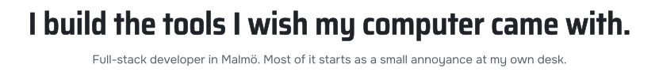
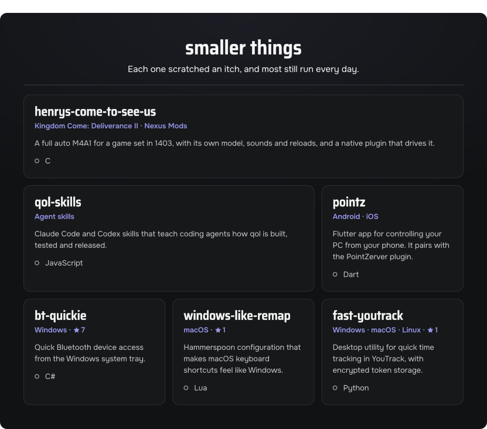

<picture>
  <source media="(prefers-color-scheme: dark)" srcset="assets/hero-dark.svg">
  
</picture>

<a href="https://github.com/qol-tools">qol-tools on GitHub</a> · <a href="https://linkedin.com/in/kmrh47">LinkedIn</a>

<a href="https://github.com/qol-tools/qol-skills">qol-skills</a> · <a href="https://github.com/qol-tools/pointz">pointz</a> · <a href="https://github.com/KMRH47/bt-quickie">bt-quickie</a> · <a href="https://github.com/KMRH47/windows-like-remap">windows-like-remap</a> · <a href="https://github.com/KMRH47/fast-youtrack">fast-youtrack</a>

