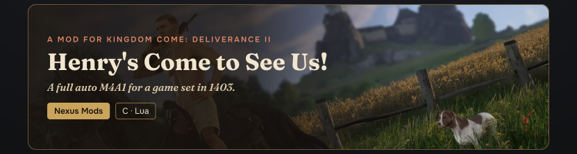
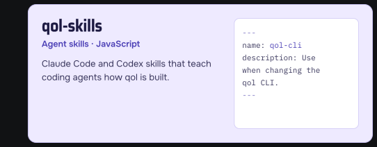
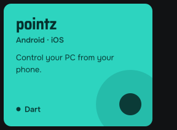
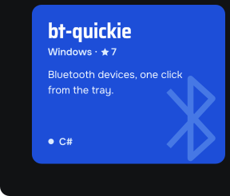
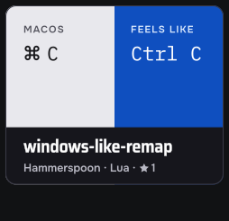
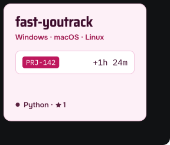

<picture>
  <source media="(prefers-color-scheme: dark)" srcset="assets/hero-dark.svg">
  
</picture>

<a href="https://github.com/qol-tools">qol-tools on GitHub</a> · <a href="https://linkedin.com/in/kmrh47">LinkedIn</a>

